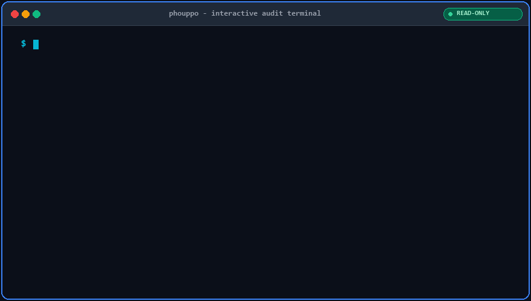
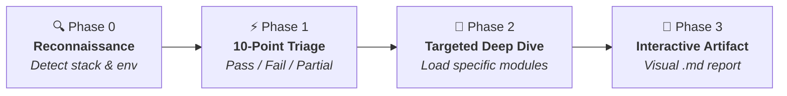

<div align="center">

# 🧐 Phouppo

**A read-only audit skill for vibe-coded apps. She notices everything.**

[](LICENSE)
[](https://cursor.com)
[](https://claude.ai/code)
[](#option-5-codex)
[](#option-6-antigravity)
[](#safety-model)

<br>


<br><br>

[Why Phouppo](#why-phouppo) • [Live Demo](#see-it-in-action) • [Coverage](#what-it-covers) • [How It Works](#how-it-works) • [Installation](#installation) • [Usage](#usage) • [Sample Report](#sample-report) • [Safety](#safety-model)

</div>

---

> **Phouppo** *(n.)*: The infamous *character* in South Asian families who catches every imperfection before you even notice, and tells you straight up.
>
> *(The name is playful branding; Phouppo conducts audits with strict engineering objectivity and delivers professional, evidence-backed reports.)*

---

<a id="why-phouppo"></a>
## 💡 Why Phouppo?

Apps generated with AI coding assistants ("vibe-coded" apps) often demo flawlessly and sail through the happy path on day one. But behind the polished UI, they routinely harbor invisible landmines:

| ✨ The AI Demo *(Day 1)* | 🚨 The Reality *(Day 30)* |
|:---|:---|
| 🎨 **Slick shadcn/ui components** & sleek dark mode | 🔓 **IDOR Vulnerabilities**: Unscoped route parameters leak cross-tenant data |
| ⚡ **Instant Supabase / Firebase integration** | 💥 **RLS Disabled**: Supabase policies set to `USING (true)` or missing |
| 💳 **Functional checkout & billing demo** | 💸 **Silent Float Drift**: IEEE 754 floating-point math causes billing errors |
| 🔐 **Seamless OAuth flow & tokens** | 🔑 **Hardcoded Secrets**: Developer tokens and `.env` keys baked into client bundles |

**Phouppo** steps in before real users do. Operating as an autonomous, read-only Agent Skill (compatible with Cursor, Claude Code, Codex, Antigravity, and any agent implementing the `SKILL.md` specification), Phouppo evaluates your code like an ensemble of a **Principal Security Engineer**, **Systems Architect**, **Data Engineer**, and **Product Manager**.

---

<a id="see-it-in-action"></a>
## 🎬 See Phouppo in Action

Phouppo outputs a high-level executive summary in chat and compiles a comprehensive, **interactive visual Markdown (`.md`) artifact** with collapsible findings and Mermaid diagrams:

<p align="center">
  
</p>

---

<a id="what-it-covers"></a>
## 🎯 What It Covers

Phouppo inspects 10 critical domains, providing structured evaluation with zero generic fluff:

| Domain | Focus & Key Checkpoints |
|:---|:---|
| 🛡️ **Security** | Secret leakage (`sk-`, `AKIA`, JWTs), server-side authorization & IDOR, Supabase/Firebase RLS policies, SQL/XSS/Command injection, file upload guards, security headers, dependency poisoning. |
| 🏛️ **Architecture** | Component boundaries, DRY business logic, API consistency, rate limits, scale bottlenecks, graceful degradation, and multi-tenancy isolation. |
| 💻 **Code Quality** | Swallowed errors (`catch {}`), frontend boundary states (empty, loading, offline), async race conditions, accessibility, and phantom/mocked features disguised as real. |
| 🎨 **Visual Design & UI** | Consistency of tokens and typography, WCAG AA color contrast, responsive layout breaks, chart states, RTL & Urdu layout fidelity, and recognizable "AI UI tells". |
| 🗄️ **Data Engineering** | Migration history, relational integrity, missing foreign keys, floating-point math on currencies, backup & restore plans, and CSV/file import validation. |
| 🚀 **DevOps & Reliability** | Environment variable management, lockfile discipline, CI/CD pipeline health, edge/serverless timeouts, observability (logging/metrics), and bus-factor risk. |
| 🧪 **Testing** | Critical-path coverage, negative edge-case test suites, auth regression tests, and acceptance test validity. |
| 🤖 **LLM Risks** | Indirect prompt injection, system prompt leakage, unbounded agent tool permissions, and API budget runaway vulnerabilities. |
| 📋 **Product & Governance** | Problem-solution alignment, user workflow drop-offs, administrative ownership, and regulatory/privacy disclosures. |
| 📚 **Documentation** | Handover package completeness, incident runbooks, disaster recovery steps, and service access matrix. |

---

<a id="how-it-works"></a>
## ⚙️ How It Works

Phouppo utilizes **progressive disclosure** to stay ultra-fast and consume minimal LLM tokens. Instead of loading encyclopedic rule sets upfront, it operates in focused phases:



1. **Reconnaissance:** Fast scan of runtime, framework, database, authentication provider, and third-party integrations (completed in under 10 tool calls).
2. **10-Point Triage:** Executes high-leverage grep/regex checks across top failure modes. Marks each as `Pass`, `Fail`, `Partial`, or `Not verified`.
3. **Targeted Deep Dive:** Dynamically loads reference modules (`references/*.md`) *only* for areas flagged during triage or explicitly requested.
4. **Actionable Interactive Report:** Delivers the full audit as an interactive visual Markdown (`.md`) artifact featuring Mermaid charts, collapsible finding cards (`<details><summary>`), visual status pills, and punch-list checklists, accompanied by an executive summary in chat.

---

<a id="installation"></a>
## 📦 Installation

Choose your agent environment below.

### Option 1: Via the Skills CLI *(Recommended)*
Installs for one or several agents with a single command:
```bash
# One agent
npx skills add SyedZeerak/phouppo -a cursor

# Several agents at once
npx skills add SyedZeerak/phouppo -a cursor -a claude-code -a codex -a antigravity
```

### Option 2: Install script *(all agents, no extra tools)*
Clone the repo, then run the installer from the repository root:
```bash
git clone https://github.com/SyedZeerak/phouppo.git
cd phouppo

bash install.sh                          # global install for all four agents
bash install.sh --agents codex,antigravity
bash install.sh --project                # install into the current project instead
bash install.sh --link                   # symlink so repo updates apply automatically
bash install.sh --uninstall
```
Windows (PowerShell):
```powershell
.\install.ps1
.\install.ps1 -Scope project -Agents codex,antigravity
```

### Option 3: Cursor
<details open>
<summary><b>Project-level or Global installation</b></summary>

<br>

**Project Level (Current Repository):**
```bash
git clone https://github.com/SyedZeerak/phouppo.git
mkdir -p .cursor/skills
cp -r phouppo/skills/phouppo .cursor/skills/
rm -rf phouppo
```

**Global Level (Available Across All Projects):**
```bash
git clone https://github.com/SyedZeerak/phouppo.git
mkdir -p ~/.cursor/skills
cp -r phouppo/skills/phouppo ~/.cursor/skills/
rm -rf phouppo
```

> [!NOTE]
> Cursor also recognizes skills in `.agents/skills/` and `.claude/skills/`. If the skill does not appear immediately, restart Cursor and check **Settings > Rules / Skills**.

</details>

### Option 4: Claude Code
<details>
<summary><b>Claude Code installation</b></summary>

<br>

```bash
git clone https://github.com/SyedZeerak/phouppo.git
mkdir -p ~/.claude/skills
cp -r phouppo/skills/phouppo ~/.claude/skills/
rm -rf phouppo
```

</details>

<a id="option-5-codex"></a>
### Option 5: Codex
<details>
<summary><b>Codex installation</b></summary>

<br>

Codex scans `.agents/skills` from your working directory up to the repository root, and `~/.agents/skills` for personal skills.

**Global:**
```bash
git clone https://github.com/SyedZeerak/phouppo.git
mkdir -p ~/.agents/skills
cp -r phouppo/skills/phouppo ~/.agents/skills/
rm -rf phouppo
```

**Project level:** copy the folder to `<your-project>/.agents/skills/phouppo` instead:
```bash
mkdir -p .agents/skills
cp -r path/to/phouppo/skills/phouppo .agents/skills/
```

Run `/skills` in Codex to confirm it is listed, and invoke it with `$phouppo`.

</details>

<a id="option-6-antigravity"></a>
### Option 6: Antigravity
<details>
<summary><b>Antigravity installation</b></summary>

<br>

**Global:**
```bash
git clone https://github.com/SyedZeerak/phouppo.git
mkdir -p ~/.gemini/antigravity/skills
cp -r phouppo/skills/phouppo ~/.gemini/antigravity/skills/
rm -rf phouppo
```

**Project level:** copy the folder to `<your-project>/.agent/skills/phouppo` instead:
```bash
mkdir -p .agent/skills
cp -r path/to/phouppo/skills/phouppo .agent/skills/
```

> [!NOTE]
> These locations follow the skills CLI conventions. Confirm them against your Antigravity version, and restart the agent if the skill does not appear.

</details>

### Invocation by agent

| Agent | Command | Output Style |
|:---|:---|:---|
| **Cursor** | `/phouppo` | Interactive `.md` file & chat |
| **Claude Code** | `/phouppo` | Interactive `.md` file & chat |
| **Codex** | `$phouppo` | Interactive `.md` file & chat |
| **Antigravity** | Mention `phouppo` in chat | Native side-pane artifact panel & chat |

---

<a id="usage"></a>
## 🚀 Usage & Options

Invoke the skill directly within your agent chat window (use `$phouppo` instead of `/phouppo` in Codex):

```bash
# Standard audit on the entire repository (default)
/phouppo

# Quick triage check (Phase 0 & 1 only)
/phouppo . --depth quick

# Full comprehensive deep dive across all 10 areas
/phouppo . --depth deep

# Focused audit on targeted subsystem and domains
/phouppo src/server --focus security,data

# Audit frontend styling and UX exclusively
/phouppo apps/web --focus visual
```

### Parameter Reference

| Flag / Argument | Options | Description |
|:---|:---|:---|
| `[scope]` | `<path>` | Relative path to audit. Defaults to `.` (repo root). Narrow scope to save tokens. |
| `--depth` | `quick` | Runs Reconnaissance & 10-Point Triage only. |
| | `standard` *(default)* | Adds Phase 2 deep-dive modules for areas flagged during triage. |
| | `deep` | Executes thorough deep-dive reviews across all 10 domains. |
| `--focus` | `comma-separated` | Limits Phase 2 to specific areas: `security`, `architecture`, `code-quality`, `visual`, `data`, `devops`, `testing`, `llm`, `product`, `docs`. |
| `--mode` | `static` *(default)* | Read files only without side effects. |
| | `tools` | Runs existing test suites and read-only linters after explicit confirmation. |
| | `dynamic` | Boots app locally in sandbox to probe endpoints after explicit confirmation. |

> [!TIP]
> The audit is automatically delivered as an interactive visual Markdown (`.md`) artifact—rendered in your agent's artifact panel (e.g. Antigravity) or written to `audit-report.md`.

---

<a id="sample-report"></a>
## 📋 Sample Report Preview

Here is an excerpt of what Phouppo produces when auditing an application. The findings below demonstrate the interactive accordion formatting and visual status badges:

````markdown
# 🧐 Vibe Code Audit Report: Acme Logistics Portal
Date: 2026-10-13 | Scope: apps/portal | Depth: standard

## 1. Executive Summary

> [!CAUTION]
> ### 🛑 Overall Readiness: NOT READY FOR PRODUCTION
> **2 Critical** and **1 High** severity issues must be resolved before go-live.

- **Primary Risk**: Any authenticated driver can access distributor payout spreadsheets via IDOR.
- **Go-Live Requirements**: Patch 2 authorization checks and enable RLS policies prior to launch (~1 day effort).

## 2. Visual Scorecard
| Domain | Rating | Open Issues | Key Reason |
|:---|:---:|:---:|:---|
| 🛡️ Security | 🔴 Critical | 2 | Unrestricted ID parameter in payout route |
| 🗄️ Data Integrity | 🟠 High | 1 | Float arithmetic used for currency totals |
| 💻 Code Quality | 🟡 Medium | 1 | Swallowed promise rejections in queue consumer |
| 🎨 Visual Design | 🟢 Good | 0 | Clean token usage; WCAG AA contrast maintained |

## 3. Interactive Findings

<details open>
<summary>🔴 <b>[SEC-01] IDOR in Distributor Payout Route</b> &mdash; <code>Critical</code> &bull; <code>Effort: S</code></summary>

| Property | Value |
|:---|:---|
| **Area** | Security |
| **Location** | `apps/portal/api/payouts/[id].ts:42` |
| **Confidence** | High |
| **Verified** | Static |

> [!CAUTION]
> **Impact**: Unauthenticated tenant data leakage across distributor organizations.

**Evidence:**
```typescript
const payout = await db.payouts.findUnique({ where: { id: req.query.id } });
return res.json(payout);
```

**Recommendation:**
Scope query to tenant: `{ id: req.query.id, organizationId: req.user.organizationId }`.

</details>

## 4. Remediation Checklist
- [ ] **[SEC-01]** Scope payout query to authenticated tenant `organizationId` (apps/portal/api/payouts/[id].ts:42)
- [ ] **[DAT-01]** Migrate invoice totals to integer cents / decimal.js (lib/billing/calculator.ts:88)
````

---

<a id="safety-model"></a>
## 🛡️ Safety Model

Phouppo is designed from the ground up to be safe to run against sensitive and proprietary codebases:

- **🔒 100% Read-Only:** Phouppo inspects code, but never edits, commits, or mutates your application's source files. Reports are delivered as interactive `.md` artifacts.
- **🙈 Secret Masking:** Detected tokens or API keys are automatically redacted (first 4 characters visible, followed by `****`).
- **🛡️ Injection Resistant:** Treats all codebase strings, READMEs, and test fixtures as untrusted user input.
- **🚫 Zero Unapproved Side Effects:** Never runs arbitrary shell commands, executes migrations, or triggers external network requests without explicit approval.
- **🎯 Evidence or Silence:** If something cannot be verified conclusively from static code, it is marked `Not verified`. No hallucinated vulnerabilities.

---

## 🤝 Companion Skills

Phouppo works seamlessly alongside other agent skills:
- **Terse output skills** (e.g. *caveman*) can manage working notes and subsequent fix generation, while preserving full fidelity for findings and evidence.
- **Minimal code skills** (e.g. *ponytail*) can guide remediation to ensure fixes remain concise and free of speculative abstractions.

---

## 📂 Repository Layout

```
phouppo/
├── assets/
│   ├── phouppo-hero.png           # High-resolution hero banner
│   └── phouppo-demo.gif           # Animated interactive audit terminal
├── README.md                      # Documentation & Quickstart
├── LICENSE                        # MIT License
├── CHANGELOG.md                   # Release history
├── CONTRIBUTING.md                # Contribution guidelines
├── AGENTS.md                      # Fallback for agents without skill support
├── install.sh                     # Installer (macOS / Linux)
├── install.ps1                    # Installer (Windows PowerShell)
└── skills/
    └── phouppo/
        ├── SKILL.md               # Main agent skill definition
        └── references/            # Modular deep-dive checklists
            ├── security.md        # Auth, IDOR, RLS, injection
            ├── architecture.md    # Multi-tenancy, API & structure
            ├── code-quality.md    # Error handling, race conditions
            ├── visual-design.md   # Design tokens, contrast, layout
            ├── data-engineering.md# Schema, migrations, math accuracy
            ├── devops.md          # CI/CD, envs, observability
            ├── testing.md         # Critical coverage, test quality
            ├── llm-risks.md       # Prompt injection, token runaway
            ├── product-governance.md # Feature fit, ownership
            ├── documentation.md   # Handover package, runbooks
            ├── stack-notes.md     # Framework-specific cheat sheets
            └── report-template.md # Standardized report schema
```

---

## ⚠️ Limitations

Phouppo provides **static, agent-assisted code review**. It does not substitute for:
- Formal, manual penetration testing
- Real-time dynamic fuzzing or live network vulnerability scanning
- Legal, HIPAA, or SOC2 compliance certification

Findings labeled `Not verified` always warrant human review.

---

## 🤝 Contributing

Contributions are warmly welcome! Whether you are adding stack-specific patterns to `stack-notes.md` or expanding check coverage:
1. Review [CONTRIBUTING.md](CONTRIBUTING.md).
2. Open an issue or submit a pull request.

---

## 📄 License

Distributed under the **MIT License**. See [LICENSE](LICENSE) for details.

---

<div align="center">

Crafted with care by **Syed Wajdan Zeerak**  
[](https://github.com/SyedZeerak)
[](https://www.linkedin.com/in/Syed-Wajdan-Zeerak)

</div>
