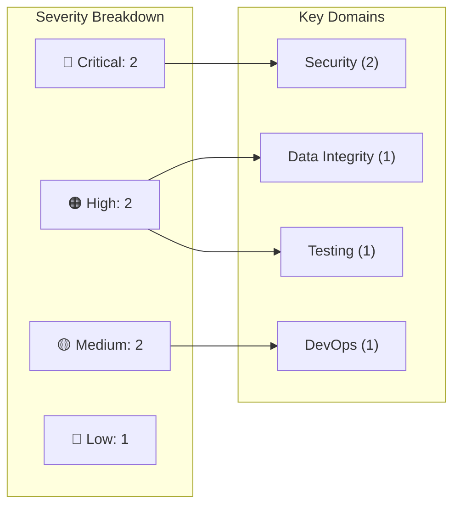
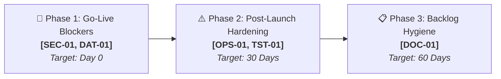

# Interactive Report Template

Follow this structure to generate an interactive, visual Markdown (`.md`) artifact. Keep the executive summary free of jargon. Do not pad sections: omit a section only if it has no content, and say so.

---

```markdown
# 🧐 Vibe Code Audit Report: <application name>

| Metadata | Details |
|:---|:---|
| **Date** | <YYYY-MM-DD> |
| **Scope** | `<paths, branches, commit if known>` |
| **Depth** | `quick` \| `standard` \| `deep` |
| **Mode** | `static` \| `tools` \| `dynamic` |
| **Commands run** | `<list, or "none">` |
| **Stack** | `<language, framework, database, hosting, integrations>` |
| **Not examined** | `<what was out of scope or could not be verified>` |

---

## 1. Executive Summary

<!-- Select the appropriate readiness banner -->
> [!CAUTION]
> ### 🛑 Overall Readiness: NOT READY FOR PRODUCTION
> **<X> Critical** and **<Y> High** severity issues must be resolved before go-live to prevent security exposure or data loss.

<!-- OR:
> [!WARNING]
> ### ⚠️ Overall Readiness: READY WITH CONDITIONS
> No Critical blockers identified, but **<Y> High** severity issues must have assigned owners and verified fixes prior to release.
-->

<!-- OR:
> [!NOTE]
> ### ✅ Overall Readiness: READY FOR PRODUCTION
> Critical-path architecture, security, and data integrity safeguards are confirmed.
-->

### Business Impact Overview
Three to six sentences in plain language for non-technical stakeholders (operations, leadership, finance).
- **Core Risk**: What is at risk in real-world business terms (e.g., unauthorized data access, corrupted revenue figures, silent workflow failures).
- **Go-Live Requirements**: Key remediations required prior to deployment.
- **Estimated Remediation Effort**: Total engineering effort (e.g., ~1.5 person-days).

---

## 2. Visual Scorecard & Metrics

| Domain | Rating | Open Issues | Key Reason |
|:---|:---:|:---:|:---|
| 🛡️ **Security** | 🔴 Critical | 2 | Missing server-side authorization checks on data endpoints |
| 🏛️ **Architecture** | 🟡 Medium | 1 | Client-side routing without server route protection |
| 💻 **Code Quality** | 🟢 Good | 0 | Consistent async error wrapping across API handlers |
| 🎨 **Visual Design & UI** | 🟢 Good | 0 | Design tokens unified, WCAG AA contrast satisfied |
| 🗄️ **Data Integrity** | 🟠 High | 1 | Floating-point math used for pricing and invoice totals |
| 🚀 **DevOps & Reliability** | 🟡 Medium | 1 | Missing CI/CD linting and automated test pipeline |
| 🧪 **Testing** | 🟠 High | 1 | Zero test coverage over financial calculation routines |
| 🤖 **LLM Risks** | ⚪ N/A | 0 | No LLM integrations present |
| 📋 **Product Fit & Governance** | 🟢 Good | 0 | Clear role boundaries and user workflows |
| 📚 **Documentation** | 🔵 Low | 1 | Missing deployment runbook for database migrations |

### Risk & Severity Distribution



---

## 3. Interactive Findings

> [!TIP]
> Findings are presented as interactive accordions. **Critical** and **High** findings are expanded by default (`<details open>`). Click any row to expand or collapse details, evidence, and remediation advice.

### 🔴 Critical & 🟠 High Findings (Blockers)

<details open>
<summary>🔴 <b>[SEC-01] IDOR in Distributor Payout Route</b> &mdash; <code>Critical</code> &bull; <code>Effort: S</code></summary>

| Property | Value |
|:---|:---|
| **Area** | Security |
| **Location** | `apps/portal/api/payouts/[id].ts:42` |
| **Confidence** | High |
| **Verified** | Static |

> [!CAUTION]
> **Impact**: Any authenticated user can view or export another distributor's private banking details and payout statements by modifying the URL ID parameter.

**Evidence:**
```typescript
// Handler queries directly by route parameter without tenant or user ownership check
const payout = await db.payouts.findUnique({ where: { id: req.query.id } });
return res.json(payout);
```

**Recommendation:**
Enforce session tenant checks in the database query:
```typescript
const payout = await db.payouts.findFirst({
  where: { id: req.query.id, organizationId: req.user.organizationId }
});
if (!payout) return res.status(404).json({ error: "Not found" });
```

</details>

<details open>
<summary>🟠 <b>[DAT-01] Floating-Point Math Used for Currency Calculations</b> &mdash; <code>High</code> &bull; <code>Effort: M</code></summary>

| Property | Value |
|:---|:---|
| **Area** | Data Integrity |
| **Location** | `lib/billing/calculator.ts:88` |
| **Confidence** | High |
| **Verified** | Static |

> [!WARNING]
> **Impact**: Rounding artifacts in floating-point math accumulate on multi-line invoices, creating discrepancies between ledger entries and actual charged totals.

**Evidence:**
```typescript
const tax = subtotal * 0.175;
const total = subtotal + tax + shipping;
```

**Recommendation:**
Represent all monetary values as integer minor units (cents) or use arbitrary-precision decimal libraries (`decimal.js` / `dinero.js`).

</details>

### 🟡 Medium, 🔵 Low, & ℹ️ Info Findings

<details>
<summary>🟡 <b>[OPS-01] Missing Rate Limiting on Authentication Endpoints</b> &mdash; <code>Medium</code> &bull; <code>Effort: S</code></summary>

| Property | Value |
|:---|:---|
| **Area** | DevOps & Reliability |
| **Location** | `src/routes/auth.ts:15` |
| **Confidence** | High |
| **Verified** | Static |

> [!NOTE]
> **Impact**: Login and OTP verification endpoints are susceptible to brute-force credential stuffing and denial-of-service.

**Evidence:**
```typescript
router.post("/login", authController.login);
```

**Recommendation:**
Attach rate-limiting middleware (e.g., `express-rate-limit` backed by Redis) allowing at most 5 attempts per IP per minute.

</details>

---

## 4. Remediation Plan & Punch List

### Visual Remediation Sequence



### Actionable Remediation Checklist

#### 🚨 Before Go-Live (Blockers)
- [ ] **[SEC-01]** Scope payout query to authenticated tenant `organizationId` (`apps/portal/api/payouts/[id].ts:42`) &mdash; *Owner: Backend Lead (Effort: S)*
- [ ] **[DAT-01]** Migrate invoice and tax math to integer cents / `decimal.js` (`lib/billing/calculator.ts:88`) &mdash; *Owner: Data Engineer (Effort: M)*

#### ⚠️ Within 30 Days (High Priority)
- [ ] **[OPS-01]** Implement IP-based rate limiting on `/login` and password reset endpoints (`src/routes/auth.ts:15`) &mdash; *Owner: DevOps (Effort: S)*
- [ ] **[TST-01]** Add regression unit tests for calculation edge cases and negative input scenarios &mdash; *Owner: QA / Backend (Effort: M)*

#### 📋 Backlog (Hygiene & Docs)
- [ ] **[DOC-01]** Complete disaster recovery runbook and offsite backup verification steps &mdash; *Owner: Tech Lead (Effort: S)*

---

## 5. Positive Observations

- 🟢 **Parameterized Database Access**: Prisma ORM is consistently used across all CRUD handlers, mitigating SQL injection risks.
- 🟢 **Design Token Discipline**: CSS variables and Tailwind design tokens are utilized systematically across components without arbitrary pixel overrides.
- 🟢 **Strict TypeScript Configuration**: `noImplicitAny` and strict null checks are active across the entire client and server repository.

---

## 6. Diagnostic History & Triage Traces

<details>
<summary><b>🔍 10-Point Triage Audit Trace</b> (Click to inspect)</summary>

| # | Check | Result | Evidence |
|:---:|:---|:---:|:---|
| 1 | Secrets exposed in repository | `Pass` | No API keys, credentials, or `.env` files tracked in git history |
| 2 | Server-side authorization & IDOR | `Fail` | Missing organization scope in `api/payouts/[id].ts:42` |
| 3 | Database access rules & RLS | `Pass` | Supabase RLS enabled with explicit tenant isolation policies |
| 4 | Input validation & injection | `Pass` | Zod schemas validate all incoming request bodies |
| 5 | Calculation & business logic | `Fail` | Floating-point arithmetic used for invoice tax computations |
| 6 | Backup and recovery | `Not verified` | No automated backup configuration in repository; host verify needed |
| 7 | Error handling & leak prevention | `Pass` | Centralized error middleware masks stack traces in production |
| 8 | Dependency health & legitimacy | `Pass` | Lockfile verified; all imported npm packages originate from official scopes |
| 9 | Rate limiting & abuse controls | `Fail` | No rate limiting configured on public auth endpoints |
| 10 | Observability & logging | `Partial` | Structured logs emitted, but error tracking service (Sentry) missing |

</details>

<details>
<summary><b>🧪 Verification Tests Performed</b> (Tools & Dynamic Modes)</summary>

| Test ID | Command / Probe | Result | Affected Findings |
|:---|:---|:---:|:---|
| `TEST-01` | `npm run test:auth` | `Pass` | Confirmed session middleware token validation |
| `TEST-02` | `curl -H "Auth: DriverToken" /api/payouts/dist-99` | `Exploited` | Verified IDOR [SEC-01] |

</details>

<details>
<summary><b>📋 Items Requiring Verification & Review Limits</b> (Click to inspect)</summary>

### Unverified Deployment Factors
- **Automated DB Backups**: Verify point-in-time recovery (PITR) configuration in managed database console.
- **Production Secret Rotation**: Ensure production API keys differ from development environment seeds.

### Audit Limitations
- Review conducted via static source analysis without full external penetration testing or live traffic load simulations.
- Sampling strategy: all API endpoints, all schema migrations, and top 20 UI components examined.

</details>
```

---

## Interactive Writing Rules

1. **Artifact Delivery**: Always format the complete audit report as an interactive Markdown (`.md`) artifact.
   - In environments supporting native agent artifacts (such as Antigravity), write to the artifact directory with `UserFacing: true`.
   - In workspace-file environments (such as Cursor, Claude Code, Codex), write to `audit-report.md`.
2. **Interactive Accordions**:
   - Use `<details open>` for all **Critical** and **High** findings so blockers are immediately visible.
   - Use `<details>` (collapsed) for **Medium**, **Low**, and **Info** findings to keep the report clean and scannable.
   - Enclose secondary diagnostic tables (10-point triage trace, dynamic tests, audit limitations) in collapsible `<details>` tags.
3. **Mermaid Diagrams**:
   - Always include a Severity Breakdown diagram and a Remediation Roadmap sequence (`flowchart LR`).
   - Use quotes for labels containing special characters or punctuation.
4. **Actionable Punch Lists**:
   - Provide interactive GitHub task checkboxes (`- [ ]`) in the remediation plan grouped by milestone ("Before Go-Live", "Within 30 Days", "Backlog") so teams can use the report as an operational checklist.
5. **Severity Badges & Callouts**:
   - Use visual status pills: `🔴 Critical`, `🟠 High`, `🟡 Medium`, `🔵 Low`, `🟢 Good`, `⚪ Not verified`.
   - Highlight business impact and readiness using GitHub alerts (`> [!CAUTION]`, `> [!WARNING]`, `> [!NOTE]`).
6. **Masking & Safety**:
   - Always redact keys, credentials, personal emails, and machine paths.
